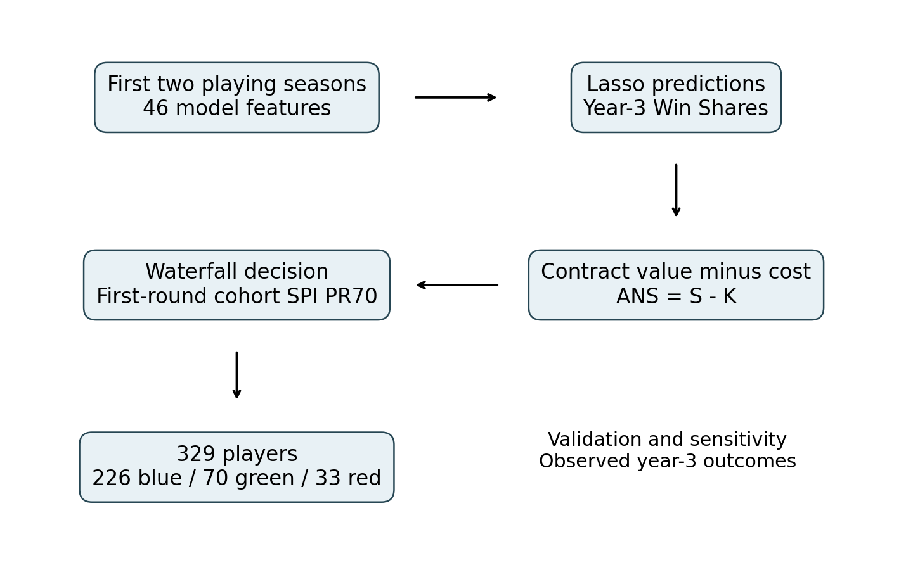
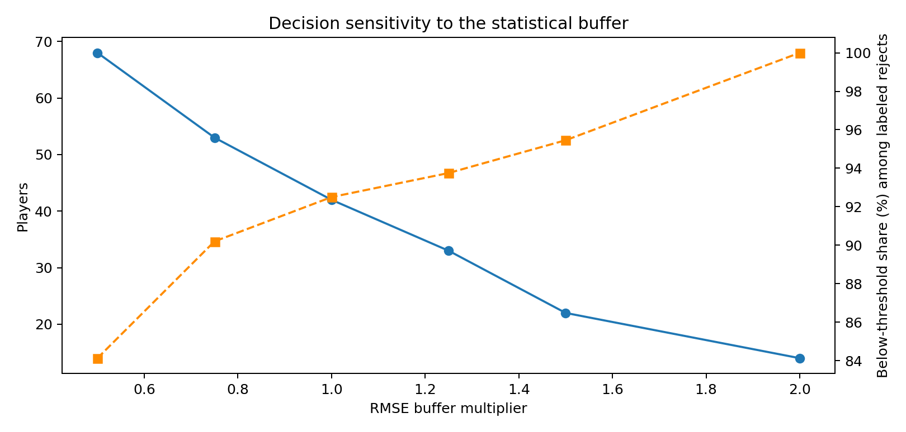

# Should the Team Pick Up the Option?
### Data-Driven Real Options Valuation for NBA Rookie-Scale Team Options

**English** | [繁體中文](README.zh-TW.md)

### 🏀 [Try the live app](https://aqx-databowl-nba-rookie-options.vercel.app/)

Backup: [Streamlit version](https://aqx-databowl-nba-rookie-options-ca5mtsplouqtjfxwktnrku.streamlit.app/)

[](https://www.kaggle.com/datasets/sumitrodatta/nba-aba-baa-stats)
[](https://www.kaggle.com/datasets/yhsarawang/nba-players-first-two-year-average-data)
[](https://www.python.org/)
[](https://streamlit.io/)

Under the NBA's Collective Bargaining Agreement, a first-round pick's rookie-scale contract guarantees two seasons; the third and fourth seasons are **team options**. Front offices must decide whether to keep a young player after watching only one or two seasons, and those decisions are prone to the **sunk-cost fallacy** — high picks get more rope simply because they were high picks (Staw & Hoang, 1995).

This project treats each rookie as a financial asset and combines:

- **Machine learning** — forecast a player's year-3 Win Shares from 46 features of his first two seasons
- **NLP** — turn rookie-season news coverage into a *Star Power Index* using RoBERTa sentiment
- **Real options valuation** — treat "exercise the team option?" as pricing a call option, with a five-gate decision waterfall

The result is an interactive decision system with an AI scouting report (OpenAI), backtested on every first-round pick from the 2013–2023 cohorts.

> **Headline result:** of 329 first-round picks, the system says **226 exercise / 70 keep / 33 decline**. Of the 32 declined players who reached a third season, **30 (93.75%) really did produce below the replacement-level bar**. The research code and full outputs live in `scripts/research_no_injury.py` and `results/no_injury/`; the web app uses exactly the same rules.

---

## Contents

- [Pipeline overview](#pipeline-overview)
- [Data](#data)
- [1. Data processing and NLP pipeline](#1-data-processing-and-nlp-pipeline)
- [2. Model training and comparison](#2-model-training-and-comparison)
- [3. From Win Shares to an option decision](#3-from-win-shares-to-an-option-decision)
- [4. Backtest results](#4-backtest-results)
- [5. Interactive web app](#5-interactive-web-app)
- [Repository structure](#repository-structure)
- [Setup and usage](#setup-and-usage)
- [Limitations and future work](#limitations-and-future-work)

---

## Pipeline overview

```
Kaggle stats history ─┐
                      ├─▶ Feature engineering (build_feature_dataset.ipynb)
Custom news scraper  ─┘         │
      │                         ▼
      ▼                  Model training & selection
Sentiment (RoBERTa)      (6 models compared → Lasso)
      │                         │
      └──────────┬──────────────┘
                 ▼
   Financial valuation + five-gate waterfall (scripts/research_no_injury.py)
                 │
       ┌─────────┼──────────────┐
       ▼                        ▼
Historical backtest      Streamlit app + AI scouting reports
                         (webapp/app.py)
```



## Data

| Data | Description | Source |
| --- | --- | --- |
| NBA player stats | 1980–2023 basic and advanced stats (PER, BPM, VORP, USG%, ...) | [Kaggle: nba-aba-baa-stats](https://www.kaggle.com/datasets/sumitrodatta/nba-aba-baa-stats) |
| First-two-seasons table | Players entering the league 2000–2023: averages over their first two seasons, labeled with year-3 Win Shares | [Kaggle: our dataset](https://www.kaggle.com/datasets/yhsarawang/nba-players-first-two-year-average-data) |
| Player news | Headlines from each player's rookie window, collected with a custom scraper (2000–2023, one file per year) | `notebooks/data_pipeline/scrape_player_news.ipynb` |
| Draft and college data (Basketball/Sports-Reference) | Draft position and college stats used to fill gaps for second-rounders and missing features | `notebooks/data_pipeline/build_feature_dataset.ipynb` |

---

## 1. Data processing and NLP pipeline

News sentiment and coverage volume capture off-court information. See `notebooks/data_pipeline/`:

| Notebook | Purpose |
| --- | --- |
| `build_feature_dataset.ipynb` | Merges Kaggle stats, draft position and college data; normalizes names, handles missing values and extracts rookie-window features. Produces `NBA_Normalized_Final.csv` and `NBA_Player_Final_Master_Features.csv` |
| `scrape_player_news.ipynb` | Custom news scraper with TF-IDF de-duplication. Produces `NBA_News_{year}_Full_Cohort.csv` |
| `sentiment_analysis.ipynb` | Scores headlines with a Transformer sentiment model and aggregates them into the `Star_Power_Index` |

**Scraper design**
- Uses `undetected-chromedriver` with no hard-coded version, adapting to the local Chrome install
- Rebuilds the browser profile for every search to avoid cache corruption and process lock-ups
- Randomized pauses (5–9 s short, 20–45 s long) and simulated scrolling to stay polite to the search engine
- Restricts results to each player's rookie window with the `tbs=cdr:1,cd_min:...,cd_max:...` date filter

**Text cleaning and scoring**
- `langdetect` removes non-English noise
- `TfidfVectorizer` + cosine similarity (threshold 0.85) removes syndicated duplicates
- Bayesian smoothing stabilizes sentiment for players with little coverage; `Star_Power_Index` measures relative buzz, and the rescue bar is the 70th percentile among first-round picks of the same cohort

---

## 2. Model training and comparison

Features (`X`) are a rookie's basic and advanced stats from his **first two seasons**; the target (`y`) is **year-3** Win Shares (`Year3_WS`). Code is in `notebooks/models/`:

| Notebook | Model |
| --- | --- |
| `RandomForest.ipynb` | Random Forest |
| `RidgeRegression.ipynb` | Ridge Regression |
| `Lasso.ipynb` | Lasso Regression (**selected**) |
| `ElasticNet.ipynb` | Elastic Net |
| `GradientBoost.ipynb` | Gradient Boosting |
| `PLS.ipynb` | PLS Regression |

### Model comparison

| Model | Best CV R² | Test R² | RMSE | MAE | MedianAE | CV RMSE | Train-Test Gap | Spearman |
| :--- | :---: | :---: | :---: | :---: | :---: | :---: | :---: | :---: |
| **Gradient Boost** | 0.5718 | 0.5626 | 1.6916 | 1.2571 | 0.9955 | 1.7642 ± 0.1842 | 0.1775 | 0.6526 |
| **Random Forest** | 0.5570 | 0.5280 | 1.7572 | 1.2734 | 0.9104 | 1.8013 ± 0.1442 | 0.2411 | 0.6620 |
| **Ridge** | 0.5530 | 0.5910 | 1.5696 | 1.2149 | 0.9149 | 1.7825 ± 0.1282 | -0.1357 | 0.6859 |
| **Elastic Net** | 0.5562 | 0.5788 | 1.5487 | 1.2079 | 0.9094 | 1.7816 ± 0.1342 | -0.2098 | 0.7167 |
| **Lasso** | 0.5562 | 0.5756 | 1.5411 | 1.2012 | — | 1.7783 ± 0.1349 | -0.2112 | 0.7209 |
| **PLS** | 0.5486 | 0.5816 | 1.5436 | 1.1928 | 0.8728 | 1.7875 ± 0.1217 | -0.1852 | 0.7079 |

- **Accuracy:** in this original comparison, Lasso has the lowest test RMSE (1.5411), PLS the lowest MAE (1.1928) and Ridge the highest test R² (0.5910). The models were not all run on identical data versions and splits, so the table is indicative rather than a strict head-to-head.
- **Generalization:** Lasso and Elastic Net have the smallest CV RMSE spread and a negative train-test gap, while Random Forest's larger gap (0.2411) signals more overfitting risk.

$\Rightarrow$ **Lasso Regression** powers the decision engine. Deployed parameters (`webapp/train_model.py`): 46 features, `alpha ≈ 0.0492`, test R² = 0.577, test RMSE = 1.786, 1,001 training and 251 test players.

---

## 3. From Win Shares to an option decision

The research analysis (`scripts/research_no_injury.py`) converts the Win Shares forecasts into contract decisions without retraining the model. The formulas below are an estimation framework, not real market prices.

#### 1. Value of a Win Share and the player's implied salary
- The Lasso model forecasts year-3 production $\widehat{WS}$.
- The season's salary cap and BRI factor give the marginal market value of one Win Share:

$$Marginal\ Value\ per\ WS = \frac{Salary\ Cap \times Team\ Count \times BRI\ Factor}{Total\ Games}$$

- This yields the share of the salary cap the player "should" earn:

$$Pred\ Salary\ Share\ Percent = \left[ \frac{\widehat{WS} \times Marginal\ Value\ per\ WS}{Salary\ Cap} \right] \times 100\%$$

#### 2. Expected value
Expected value comes straight from the year-3 forecast and the conversion above, in the same salary-cap units as the contract cost. No separate injury discount is applied in the main analysis:

$$Adjusted\ Pred\ Salary\ Percent = Pred\ Salary\ Share\ Percent$$

#### 3. Contract cost
Rookie-scale salaries are set by draft position under the CBA. Each pick is converted to a share of the salary cap (`Est_Cost_Percent`, from about 8.0% for pick 1 to 1.5% for pick 30), giving the paper surplus:

$$Net\ Value\ Surplus = Adjusted\ Pred\ Salary\ Percent - Est\ Cost\ Percent$$

#### 4. Dynamic replacement bar
Letting a costly high pick go frees cap space to buy a replacement on the open market, so the bar to keep him rises with his cost (floor: a minimum-salary veteran at about 1.8% of the cap, roughly 0.64 WS).

Let $V = 30 \times BRI / 1230 \times 100$; then $Dynamic\ Truth\ WS = \max(Est\ Cost\ Percent, 1.8) / V$.

#### 5. Five-gate decision waterfall
A single hard threshold is easily fooled by model noise. The waterfall checks the gates top-down and stops at the first one the player passes, reflecting the option's time value:

| Gate | Condition | Meaning |
| :--- | :--- | :--- |
| 🔵 Clear surplus | `Net_Value_Surplus > 0` | Expected value exceeds contract cost: exercise |
| 🟢 Statistical buffer | Loss ≥ `-1.25 × RMSE` | Within model error (1.25× reflects the option's time value): keep rather than cut a possible late bloomer |
| 🟢 Opportunity cost | $\widehat{WS} \ge Dynamic\ Truth\ WS$ | Still out-produces a free-market replacement: keeping him beats letting him go |
| 🟢 Star-power rescue | Cohort SPI ≥ 70th percentile and net surplus ≥ `-1.5 × (1.25 × RMSE)` | Off-court buzz as a tiebreaker; not validated against real revenue |
| 🔴 Stop loss | None of the above | Decline the option and free the cap space |

Under the current formulas, passing gate 3 implies a non-negative surplus, which gates 1–2 already cover, so gate 3 never rescues anyone in practice. Comparing RMSE (in WS) with a salary-cap percentage also mixes units; the buffer should be read as a decision-rule setting, not a calibrated financial confidence interval.

Example: 2023 cohort (x-axis: contract cost as % of cap; y-axis: predicted WS)


---

## 4. Backtest results

The study covers 329 first-round picks; 306 have a year-3 Win Shares record and can be scored. The other 23 are still classified but are not treated as zero. A call is scored by whether the player reached the dynamic replacement bar, which is not the same as what the team actually did. Blue and green count as "keep"; red counts as "decline". Full outputs are in `results/no_injury/`.

| Metric | Result |
| --- | --- |
| Exercise / keep / decline | 226 / 70 / 33 |
| Declined players with a year-3 record | 32, of whom 30 fell below the bar (93.75%) |
| Declined players with no year-3 record | 1, listed separately rather than counted as 0 WS |
| Accuracy on all scored players | 207 / 306 = 67.65% |
| TP / FP / TN / FN | 177 / 97 / 30 / 2 |
| Decision score | 940 (TP +10, FP −10, TN +5, FN −5) |
| What teams actually did with the declined players | 19 confirmed busts, 8 traded, 6 possible false positives; external events not yet fully verified |
| Confirmed-bust share excluding trades | 19 / 25 = 76.0% (not the same as the production hit rate) |
| Net surplus proxy by team outcome | +58.25 cap-percentage points (a proxy, not realized savings) |
| Forecast error on scored declined players | MAE 0.847 WS, mean bias −0.101 |

The model is deliberately conservative: it almost never declines a player who turns out good (2 false negatives), at the cost of keeping many who fall short. That matches the asymmetry teams face, since keeping a cheap rookie one season too long costs little.

Accuracy is 66.27% for the earlier 166 players and 69.29% for the later 140. This split shows sample differences only; the predictions and data had already been examined, so it is not a blind or leakage-free out-of-time test.




---

## 5. Interactive web app

`webapp/` is a bilingual (English / 繁體中文) Streamlit app. It applies the same rules and the same star-power bar as the research analysis and reproduces the 226 / 70 / 33 result exactly.

- **🔎 Player lookup** — pick a cohort (2013–2023) and a player to see each gate's condition, actual value and threshold, and how the call compares with the player's real year-3 output and whether the team kept him
- **🗺️ Cohort explorer** — contract cost vs. expected value for every first-round pick in a cohort; players above the break-even line are projected bargains
- **📊 Backtest** — decisions by cohort, stop-loss hit rate, net benefit, the keep/decline confusion matrix and the full stop-loss list
- **🎛️ What-if** — move the statistical buffer, star-power percentile and rescue tolerance to re-run all 329 decisions live and see who changes
- **✍️ New player** — enter a player's first-two-season stats and draft pick for an instant forecast and decision
- **🧠 AI scouting report** — an OpenAI model (`gpt-5-mini` by default) writes a 3–5 sentence report grounded only in the player's numbers and decision (`webapp/report_generator.py`)

"Cohort" means the calendar year the rookie season ended: the 2020 cohort is the 2019 draft class.

### Vercel version (`web/`)

`web/` is the same app rebuilt as a static React + TypeScript site for Vercel. Everything except the AI report runs in the browser:

- `web/scripts/export_data.py` exports the study sample, the Lasso pipeline (median imputation → standardization → coefficients) and the UI text to JSON. It asserts that the exported linear formula reproduces the scikit-learn pipeline.
- `web/src/lib/engine.ts` ports the waterfall, backtest and what-if logic. `npm run verify` checks it against the Python version: all 329 decisions, every backtest metric, manual-player predictions and the 0.5× sensitivity case (68 declines) must match.
- `web/api/report.ts` is the only server code: a Vercel Function that calls OpenAI with the key from the `OPENAI_API_KEY` environment variable, so the key never reaches the browser.

```bash
cd web
npm install
cp .env.example .env.local   # add your OpenAI key for the AI report
npm run dev                  # http://localhost:5173
npm run verify               # browser engine vs. Python results
```

To deploy, import the GitHub repo in Vercel, set **Root Directory** to `web`, and add `OPENAI_API_KEY` under Environment Variables.

---

## Repository structure

```
├── README.md                     # English
├── README.zh-TW.md               # 繁體中文
├── requirements.txt              # data pipeline and model training
├── notebooks/
│   ├── models/                   # six models trained and compared
│   │   ├── RandomForest.ipynb
│   │   ├── RidgeRegression.ipynb
│   │   ├── Lasso.ipynb
│   │   ├── ElasticNet.ipynb
│   │   ├── GradientBoost.ipynb
│   │   └── PLS.ipynb
│   └── data_pipeline/            # data collection and feature engineering
│       ├── build_feature_dataset.ipynb
│       ├── scrape_player_news.ipynb
│       └── sentiment_analysis.ipynb
├── webapp/                       # Streamlit decision app
│   ├── app.py                    # UI and tabs
│   ├── decision_engine.py        # valuation, waterfall, backtest
│   ├── charts.py                 # Plotly charts
│   ├── i18n.py                   # English / Chinese strings
│   ├── report_generator.py       # AI scouting reports (OpenAI)
│   ├── train_model.py
│   ├── requirements.txt
│   ├── .env.example
│   └── models/
│       ├── lasso_pipeline.pkl
│       └── model_meta.json
├── scripts/
│   ├── research_no_injury.py     # main research analysis → results/no_injury/
│   ├── generate_decision_charts.py
│   └── validate_declined_players.py
├── results/
│   ├── no_injury/                # current results, tables and charts
│   └── injury_supplement/        # injury-discount experiments (not used)
├── data/                         # feature tables, predictions, validation labels
└── images/                       # charts from an earlier version of the analysis
```

## Setup and usage

### Run the web app

```bash
cd webapp
pip install -r requirements.txt
cp .env.example .env        # optional: add your OPENAI_API_KEY for AI scouting reports
streamlit run app.py
```

The trained model is already in `webapp/models/`. To retrain it from `data/NBA_Normalized_Final.csv`, run `python train_model.py`.

### Reproduce the research analysis

```bash
pip install -r requirements.txt
python scripts/research_no_injury.py          # writes results/no_injury/
```

### Re-run the data pipeline and model notebooks

The notebooks under `notebooks/` form the full pipeline: run `data_pipeline/` first to build the feature tables, then any notebook in `models/` to train and evaluate. The scraper notebooks need a local Chrome install.

## Limitations and future work

- **Sample size:** about 1,000 training players (2000–2023) and a test R² around 0.55–0.59 leave real forecast error, which is why the engine uses several safety nets instead of one hard cutoff.
- **Late bloomers:** the model systematically under-forecasts players who break out in year 3 (for example, Darius Garland: forecast 0.79 WS, actual 6.3 WS and an All-Star selection). Recommendations should support, not replace, coaching judgment.
- **Decision timing:** using two seasons of data matches the fourth-year option decision; the third-year option is due after only one season and would need a model trained on rookie-season data alone.
- **Scraper stability:** the news scraper depends on search-results page structure and may need updating when it changes.
- **Backtest scope:** all 329 players are classified and 306 can be scored; team-outcome labels mostly cover the declined group. `results/no_injury/` is the source of truth; other notebooks and CSVs are kept as a record of the work.
- **Injury data:** an earlier version discounted players by the number of absences longer than 27 days, but missing records cannot be read as good health and a missed game is not always an injury. Since a complete injury history could not be verified, the discount is not part of the final model. With the WS forecasts fixed and a 0.8 weight, it improved 4 calls and worsened 2 among the earlier 166 players, and improved only one (Hunter) among the later 140; removing that player or his cohort erased the advantage. That is not evidence of a stable effect, nor proof that it is pure chance. The 46 features include no separate games-played column, so the model does not claim to capture health risk. See `results/injury_supplement/`.
- **Done:** AI scouting reports, originally listed as future work, are implemented in `webapp/report_generator.py`.
- **Planned:** track the real ROI of "exercise" decisions, and test whether the approach transfers to other leagues (WNBA, overseas leagues).
