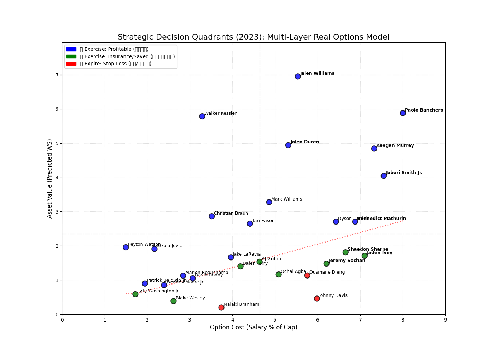
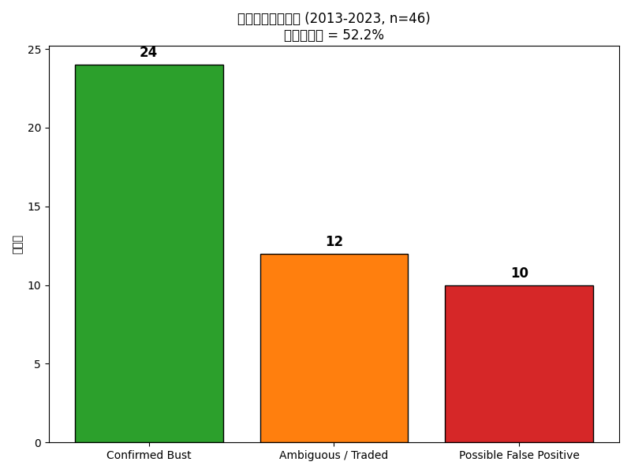

# NBA 新秀選擇權自動化決策系統
### Data-Driven Real Options Valuation for NBA Rookie-Scale Team Options

[](https://www.kaggle.com/datasets/sumitrodatta/nba-aba-baa-stats)
[](https://www.kaggle.com/datasets/yhsarawang/nba-players-first-two-year-average-data)
[](https://www.python.org/)
[](https://streamlit.io/)

在 NBA 勞資協議（CBA）下，首輪新秀合約的第三、四年是球隊的「Team Option」。傳統球探決策常受限於**沉沒成本謬誤（高順位迷思）**與**主觀偏見**，導致球隊套牢在高薪水貨、鎖死薪資空間。

本專題把球員視為一項金融資產，結合

- **機器學習**：用新秀前兩年的表現預測第三年產能（Win Shares）
- **NLP 輿情分析**：把場外新聞聲量與傷病紀錄轉化為可量化的風險 / 商業變數
- **實質選擇權定價（Real Options Valuation）**：把「是否執行球隊選擇權」當成一個選擇權定價問題

打造一套具備多層防護網的自動化決策系統，並串接 Claude LLM 產出球探報告，最終以真實歷史案例回測系統的判斷準確率。

---

## 目錄

- [系統流程總覽](#系統流程總覽)
- [資料集](#資料集)
- [一、資料處理與 NLP 輿情分析 Pipeline](#一資料處理與-nlp-輿情分析-pipeline)
- [二、機器學習模型訓練與比較](#二機器學習模型訓練與比較)
- [三、Win Share 預測與球隊選擇權決策引擎](#三win-share-預測與球隊選擇權決策引擎)
- [四、歷史回測驗證結果](#四歷史回測驗證結果)
- [五、Streamlit 決策系統網站](#五streamlit-決策系統網站)
- [專案結構](#專案結構)
- [環境設定與執行方式](#環境設定與執行方式)
- [限制與未來規劃](#限制與未來規劃)

---

## 系統流程總覽

```
Kaggle 歷史數據 ─┐
                 ├─▶ 特徵工程 (build_feature_dataset.ipynb)
自建新聞爬蟲    ─┘         │
      │                    ▼
      ▼             機器學習模型訓練與選型
情感分析 (RoBERTa)   (6 模型比較 → Lasso 勝出)
      │                    │
      └────────┬───────────┘
               ▼
   財務定價 + 五層瀑布流決策引擎 (decision_engine.py)
               │
     ┌─────────┼─────────────┐
     ▼                       ▼
歷史案例回測驗證      Streamlit 網站 + Claude LLM 球探報告
(validate_declined_players.py)   (webapp/app.py)
```

## 資料集

| 資料 | 說明 | 來源 |
| --- | --- | --- |
| NBA 球員歷年數據 | 1980–2023 賽季基礎 / 進階數據（PER、BPM、VORP、USG% 等） | [Kaggle: nba-aba-baa-stats](https://www.kaggle.com/datasets/sumitrodatta/nba-aba-baa-stats) |
| 新秀前兩年整理表 | 篩選 2000–2023 進入聯盟球員，前兩年平均表現 + 第三年 WS 標籤 | [Kaggle: 自建資料集](https://www.kaggle.com/datasets/yhsarawang/nba-players-first-two-year-average-data) |
| 球員相關新聞 | 自建爬蟲抓取的新秀期間新聞標題（2000–2023，依年份分檔） | 本專案 `notebooks/data_pipeline/scrape_player_news.ipynb` |
| Basketball/Sports-Reference 選秀 & 大學數據 | 選秀順位、大學數據，用於補齊二輪秀 / 缺失特徵 | 本專案 `notebooks/data_pipeline/build_feature_dataset.ipynb` |

---

## 一、資料處理與 NLP 輿情分析 Pipeline

傳統數據無法量化「傷病隱患」與「場外商業價值」，因此本專題開發了一套具備抗封鎖機制的自動化爬蟲與 NLP 管線，對應 `notebooks/data_pipeline/`：

| Notebook | 功能 |
| --- | --- |
| `build_feature_dataset.ipynb` | 整合 Kaggle 歷年數據、選秀順位、大學數據，做名稱標準化、缺失值處理與新秀年特徵抽取，產出 `NBA_Normalized_Final.csv` / `NBA_Player_Final_Master_Features.csv` |
| `scrape_player_news.ipynb` | 自建反封鎖新聞爬蟲 + TF-IDF 去重，產出各年份 `NBA_News_{year}_Full_Cohort.csv` |
| `sentiment_analysis.ipynb` | 用 Transformer 情感模型為新聞標題打分，聚合成 `Star_Power_Index`（商業聲量）與 `Worst_Injury_History`（傷病紅旗指數） |

**擬真抗封鎖爬蟲設計**：
- 捨棄傳統 Selenium，改用 `undetected-chromedriver` 並移除硬編碼版本號，動態適應本機 Chrome 版本
- 每次檢索自動清除並重建瀏覽器 profile，避免快取毀損導致的進程鎖死
- 注入隨機休眠（短休 5–9 秒／長休 20–45 秒）與模擬滑鼠滾動，降低觸發 Google reCAPTCHA 的機率
- 用 `tbs=cdr:1,cd_min:...,cd_max:...` 參數精準鎖定球員新秀期間的新聞區間

**文本清洗與量化**：
- `langdetect` 過濾非英語雜訊
- `TfidfVectorizer` + Cosine Similarity（門檻 0.85）去除內容農場重複轉載
- 最終彙總為兩個決策引擎會用到的量化欄位：`Worst_Injury_History`、`Star_Power_Index`

---

## 二、機器學習模型訓練與比較

以新秀**前兩年**基礎與進階數據為特徵（`X`），預測**第三年** Win Shares（`Year3_WS`，`y`）。完整程式碼見 `notebooks/models/`：

| Notebook | 模型 |
| --- | --- |
| `RandomForest.ipynb` | Random Forest |
| `RidgeRegression.ipynb` | Ridge Regression |
| `Lasso.ipynb` | Lasso Regression（**最終採用**） |
| `ElasticNet.ipynb` | Elastic Net |
| `GradientBoost.ipynb` | Gradient Boosting |
| `PLS.ipynb` | PLS Regression |

### 模型成效對比

| 模型 | Best CV R² | Test R² | RMSE | MAE | MedianAE | CV RMSE | Train-Test Gap | Spearman |
| :--- | :---: | :---: | :---: | :---: | :---: | :---: | :---: | :---: |
| **Gradient Boost** | 0.5718 | 0.5626 | 1.6916 | 1.2571 | 0.9955 | 1.7642 ± 0.1842 | 0.1775 | 0.6526 |
| **Random Forest** | 0.5570 | 0.5280 | 1.7572 | 1.2734 | 0.9104 | 1.8013 ± 0.1442 | 0.2411 | 0.6620 |
| **Ridge** | 0.5530 | 0.5910 | 1.5696 | 1.2149 | 0.9149 | 1.7825 ± 0.1282 | -0.1357 | 0.6859 |
| **Elastic Net** | 0.5562 | 0.5788 | 1.5487 | 1.2079 | 0.9094 | 1.7816 ± 0.1342 | -0.2098 | 0.7167 |
| **Lasso** | 0.5562 | 0.5756 | 1.5411 | 1.2012 | — | 1.7783 ± 0.1349 | -0.2112 | 0.7209 |
| **PLS** | 0.5486 | 0.5816 | 1.5436 | 1.1928 | 0.8728 | 1.7875 ± 0.1217 | -0.1852 | 0.7079 |

- **精準度**：各模型的交叉驗證 R² 相近（0.54–0.57），但 Lasso 在盲測集上的 RMSE（1.5411）與 MAE（1.2012）最低——在需要精確量化合約價值的場景中，誤差最小的模型最實用。
- **泛化能力**：Lasso 與 Elastic Net 的 CV RMSE 標準差最小、Train-Test Gap 為負值（代表測試集表現甚至優於訓練集），相較之下 Random Forest 的 Train-Test Gap 偏高（0.2411），過擬合風險較高。

$\Rightarrow$ **最終選定 Lasso Regression** 作為決策引擎的核心預測模型（實際部署參數見 `webapp/train_model.py`：46 個特徵、`alpha ≈ 0.0492`、Test R² = 0.577、Test RMSE = 1.786，訓練樣本 1,001 筆／測試樣本 251 筆）。

---

## 三、Win Share 預測與球隊選擇權決策引擎

為讓 Win Share 真實反映球員報酬，並消弭不同年代貨幣價值波動造成的誤差，決策引擎（`webapp/decision_engine.py`）依序執行以下五個階段：

#### 1. 球員實質價值與理論薪資估算
- 用 Lasso 模型預測球員第三年的預期產能 $\widehat{WS}$
- 結合該年度薪資上限（Salary Cap）與 BRI Factor，換算每單位 WS 的市場邊際價值：

$$Marginal\ Value\ per\ WS = \frac{Salary\ Cap \times Team\ Count \times BRI\ Factor}{Total\ Games}$$

- 推導出球員在健康市場機制下應得的理論薪資佔比：

$$Pred\ Salary\ Share\ Percent = \left[ \frac{\widehat{WS} \times Marginal\ Value\ per\ WS}{Salary\ Cap} \right] \times 100\%$$

#### 2. 傷病風險校正
依球員生涯前兩年缺賽場次與受傷部位，給予 0–3 分嚴重度評分，每 1 級風險扣減 0.8% 團隊薪資空間（此權重來自對 2000–2023 歷史數據 0.0%–5.0% 的 1D Grid Search 回測，能同時避開高薪水貨與避免錯殺潛力股）：

$$Adjusted\ Pred\ Salary\ Percent = Pred\ Salary\ Share\ Percent - (Worst\ Injury\ History \times 0.8\%)$$

#### 3. 定額合約成本基準
依 CBA 規定，新秀合約薪資與選秀順位高度相關。系統依選秀順位換算出合約成本佔薪資帽比例（`Est_Cost_Percent`），並算出帳面盈虧：

$$Net\ Value\ Surplus = Adjusted\ Pred\ Salary\ Percent - Est\ Cost\ Percent$$

#### 4. 動態機會成本及格線
高順位新秀成本高，放走他釋出的薪資空間能在自由市場買到更多替代資產，因此續約及格線需動態調高（底薪替代成本約 1.8% 薪資帽、保底產能約 0.64 WS）：

$$Dynamic\ Truth\ WS = \max\left( \frac{Est\ Cost\ Percent}{Marginal\ Value\ per\ WS},\ 0.64 \right)$$

#### 5. 多層瀑布流決策矩陣
單純用數值高低做二分判定容易被統計噪聲誤導，因此系統設計了由上而下的多層防護網（實質選擇權概念），對應 `apply_waterfall()`：

| 關卡 | 判定條件 | 決策說明 |
| :--- | :--- | :--- |
| 🔵 絕對獲利區 | `Net_Value_Surplus > 0` | 扣除風險折價後仍高於合約成本，絕對正資產 |
| 🟢 統計容錯區 | 虧損 ≥ `-1.25 × RMSE` | 落於模型統計誤差內（1.25 倍為買權時間價值），避免因誤差錯殺潛力股 |
| 🟢 動態機會成本救贖 | $\widehat{WS} \ge Dynamic\ Truth\ WS$ | 場上產能仍優於自由市場替代方案，留下他虧損反而比放走划算 |
| 🟢 商業聲量救場 | 聲量位居同梯次 PR70 以上，且虧損 ≥ `-1.5 × RMSE` | 超級巨星效應：票房、周邊、轉播等外部性可彌補場上的產能落差 |
| 🔴 絕對止損區 | 以上皆未通過 | 建議不執行選擇權，釋出薪資空間 |

決策結果視覺化範例（X 軸：合約成本佔比，Y 軸：預測 WS）：



---

## 四、歷史回測驗證結果

系統對 2013–2023 年、被模型判定應「止損（不執行選擇權）」的球員做逐一回溯驗證（`scripts/validate_declined_players.py`），確認模型判斷是否對應到真實結局：

| 指標 | 結果 |
| --- | --- |
| 模型判定止損總筆數 | 46 |
| ✅ Confirmed Bust（判斷正確） | 24 筆（52.2%） |
| 🔀 Ambiguous / Traded（無法單純二分，如交易後爆發） | 12 筆 |
| ❓ Possible False Positive（模型可能誤判） | 10 筆 |
| **排除 Ambiguous 後的 Precision** | **70.6%** |
| **產能面確認止損率**（沒打到第三年 或 WS 未達安全門檻） | **91.3%**（42 / 46） |
| 財務反事實：Confirmed Bust 群組避免的預估虧損總和 | 92.94%（薪資帽 %） |
| 財務反事實：False Positive 群組可能犧牲的留用價值 | 33.14%（薪資帽 %） |
| **淨效益（避免虧損 − 犧牲價值）** | **+59.80%**（薪資帽 %） |
| 紅區子集預測誤差 | MAE 0.875，平均偏差 −0.132（模型略為低估） |

驗證結果顯示：即使把「交易後才爆發」這類無法單純二分的個案排除，系統對於「該止損」球員的判斷精準度仍有 70.6%；若改以球員實際產能是否達標來看，91.3% 的止損建議都對應到球員確實沒能打出對得起合約的表現。



---

## 五、Streamlit 決策系統網站

`webapp/` 是一個 Streamlit 網站，把上述模型與決策引擎包裝成可互動查詢的工具：

- **📚 查詢歷史球員**：選擇選秀年份（2000–2023）與球員，直接顯示已算好的預測 WS、財務指標與決策燈號
- **✍️ 手動輸入新球員**：輸入任意球員的投籃 / 籃板助攻防守 / 進階數據與選秀順位，即時跑模型預測 + 財務決策
- **🧠 生成 LLM 球探報告**：串接 Claude API（`claude-haiku-4-5`），根據預測數據與決策結果自動生成一份 3–5 句話的球探報告（`webapp/report_generator.py`）

這一項也是原本專題規劃中「未來計畫導入 LLM」的部分，目前已經實作完成。

---

## 專案結構

```
nba_player_year3_option_predict/
├── README.md
├── requirements.txt              # 資料處理 + 模型訓練 pipeline 用
├── notebooks/
│   ├── models/                   # 6 個模型訓練與比較
│   │   ├── RandomForest.ipynb
│   │   ├── RidgeRegression.ipynb
│   │   ├── Lasso.ipynb
│   │   ├── ElasticNet.ipynb
│   │   ├── GradientBoost.ipynb
│   │   └── PLS.ipynb
│   └── data_pipeline/            # 資料蒐集與特徵工程
│       ├── build_feature_dataset.ipynb
│       ├── scrape_player_news.ipynb
│       └── sentiment_analysis.ipynb
├── webapp/                       # Streamlit 決策系統網站
│   ├── app.py
│   ├── decision_engine.py
│   ├── report_generator.py
│   ├── train_model.py
│   ├── requirements.txt
│   ├── .env.example
│   └── models/
│       ├── lasso_pipeline.pkl
│       └── model_meta.json
├── scripts/                      # 圖表產出與回測驗證
│   ├── generate_decision_charts.py
│   └── validate_declined_players.py
├── data/                         # 特徵表與預測 / 驗證結果
│   ├── NBA_Normalized_Final.csv
│   ├── NBA_Player_Final_Master_Features.csv
│   ├── NBA_Predicted_WS.csv
│   ├── Declined_Players_Report.csv
│   └── Declined_Players_Validation.csv
└── images/                       # 決策矩陣圖 + 驗證結果圖
    ├── Contract_Decision_2013.png ... 2023.png
    └── Validation_Summary.png
```

## 環境設定與執行方式

### 跑 Streamlit 網站

```bash
cd webapp
pip install -r requirements.txt
cp .env.example .env        # 填入你自己的 ANTHROPIC_API_KEY（LLM 球探報告用，非必要）
python train_model.py       # 從 data/NBA_Normalized_Final.csv 訓練 Lasso 模型
streamlit run app.py
```

### 重跑決策圖 / 回測驗證

```bash
pip install -r requirements.txt
python scripts/generate_decision_charts.py     # 產出 images/Contract_Decision_{year}.png
python scripts/validate_declined_players.py    # 產出 data/Declined_Players_Validation.csv + images/Validation_Summary.png
```

### 重跑資料處理 / 模型比較 notebook

`notebooks/` 底下的 notebook 依序對應完整 pipeline：先跑 `data_pipeline/` 建立特徵表，再跑 `models/` 底下任一模型 notebook做訓練與評估。爬蟲類 notebook 需要本機安裝 Chrome。

## 限制與未來規劃

- **樣本規模**：訓練樣本約 1,000 筆（2000–2023 年首輪新秀），模型 Test R² 落在 0.55–0.59，仍有一定預測誤差空間，因此決策引擎刻意用多層防護網（而非單一硬閾值）降低誤判成本。
- **爬蟲穩定性**：新聞爬蟲依賴 Google 搜尋結果頁與抗封鎖機制，Chrome / 搜尋頁結構更動時需要調整爬蟲邏輯。
- **回測樣本**：目前回測只涵蓋「模型判定止損」的 46 筆個案，尚未對「建議執行」的個案做同等規模的反向驗證。
- 已完成：LLM 球探報告生成（原規劃的未來項目，已在 `webapp/report_generator.py` 實作）。
- 規劃中：擴大回測涵蓋「建議執行」個案的實際 ROI 追蹤、支援更多聯盟（如 WNBA / 海外聯賽）的可轉移性測試。
