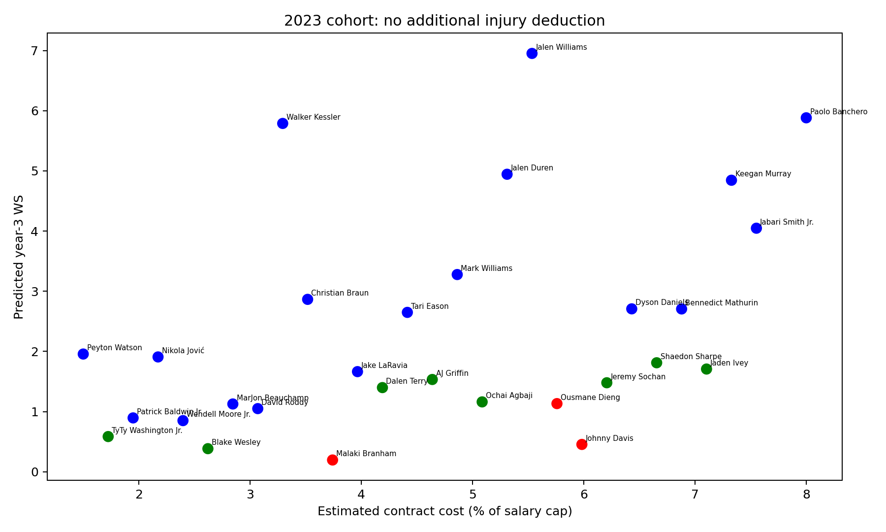
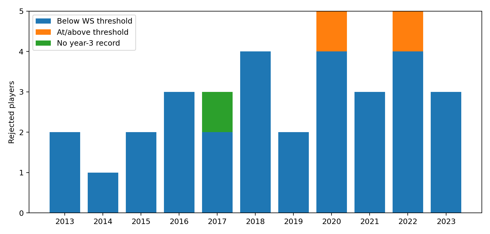

# NBA 新秀選擇權自動化決策系統
### Data-Driven Real Options Valuation for NBA Rookie-Scale Team Options

[English](README.md) | **繁體中文**

### 🏀 [開啟線上網站](https://aqx-databowl-nba-rookie-options.vercel.app/)

備用：[Streamlit 版](https://aqx-databowl-nba-rookie-options-ca5mtsplouqtjfxwktnrku.streamlit.app/)

[](https://www.kaggle.com/datasets/sumitrodatta/nba-aba-baa-stats)
[](https://www.kaggle.com/datasets/yhsarawang/nba-players-first-two-year-average-data)
[](https://www.python.org/)
[](https://streamlit.io/)

在 NBA 勞資協議（CBA）下，首輪新秀合約的第三、四年是球隊的「Team Option」。傳統球探決策常受限於**沉沒成本謬誤（高順位迷思）**與**主觀偏見**，導致球隊套牢在高薪水貨、鎖死薪資空間。

本專題把球員視為一項金融資產，結合

- **機器學習**：用新秀前兩年的表現預測第三年產能（Win Shares）
- **NLP 輿情分析**：把新聞情緒與報導量轉化為商業聲量指數
- **實質選擇權定價（Real Options Valuation）**：把「是否執行球隊選擇權」當成一個選擇權定價問題

打造一套具備多層防護網的自動化決策系統，並串接 OpenAI 模型產出球探報告，最終以真實歷史案例回測系統的判斷準確率。

> **研究分析入口**：以 46 項前兩季特徵預測第三年 WS，換算預期價值並比較合約成本，再透過統計容錯、機會成本及商業聲量條件產生分類。329 人結果為 **226 藍／70 綠／33 紅**。研究程式與完整輸出位於 `scripts/research_no_injury.py` 和 `results/no_injury/`；網站展示與研究分析的適用範圍請見下方說明。

---

## 目錄

- [系統流程總覽](#系統流程總覽)
- [資料集](#資料集)
- [一、資料處理與 NLP 輿情分析 Pipeline](#一資料處理與-nlp-輿情分析-pipeline)
- [二、機器學習模型訓練與比較](#二機器學習模型訓練與比較)
- [三、Win Share 預測與球隊選擇權決策引擎](#三win-share-預測與球隊選擇權決策引擎)
- [四、歷史回測驗證結果](#四歷史回測驗證結果)
- [五、Streamlit 決策系統網站](#五streamlit-決策系統網站)
- [專案結構](#專案結構)
- [環境設定與執行方式](#環境設定與執行方式)
- [限制與未來規劃](#限制與未來規劃)

---

## 系統流程總覽

```
Kaggle 歷史數據 ─┐
                 ├─▶ 特徵工程 (build_feature_dataset.ipynb)
自建新聞爬蟲    ─┘         │
      │                    ▼
      ▼             機器學習模型訓練與選型
情感分析 (RoBERTa)   (6 模型比較 → Lasso 勝出)
      │                    │
      └────────┬───────────┘
               ▼
   財務定價 + 五層瀑布流研究主分析 (scripts/research_no_injury.py)
               │
     ┌─────────┼─────────────┐
     ▼                       ▼
歷史案例回測驗證      Streamlit 網站 + AI 球探報告
(validate_declined_players.py)   (webapp/app.py)
```

## 資料集

| 資料 | 說明 | 來源 |
| --- | --- | --- |
| NBA 球員歷年數據 | 1980–2023 賽季基礎 / 進階數據（PER、BPM、VORP、USG% 等） | [Kaggle: nba-aba-baa-stats](https://www.kaggle.com/datasets/sumitrodatta/nba-aba-baa-stats) |
| 新秀前兩年整理表 | 篩選 2000–2023 進入聯盟球員，前兩年平均表現 + 第三年 WS 標籤 | [Kaggle: 自建資料集](https://www.kaggle.com/datasets/yhsarawang/nba-players-first-two-year-average-data) |
| 球員相關新聞 | 自建爬蟲抓取的新秀期間新聞標題（2000–2023，依年份分檔） | 本專案 `notebooks/data_pipeline/scrape_player_news.ipynb` |
| Basketball/Sports-Reference 選秀 & 大學數據 | 選秀順位、大學數據，用於補齊二輪秀 / 缺失特徵 | 本專案 `notebooks/data_pipeline/build_feature_dataset.ipynb` |

---

## 一、資料處理與 NLP 輿情分析 Pipeline

新聞情緒與報導量用於補充場外聲量資訊，對應 `notebooks/data_pipeline/`：

| Notebook | 功能 |
| --- | --- |
| `build_feature_dataset.ipynb` | 整合 Kaggle 歷年數據、選秀順位、大學數據，做名稱標準化、缺失值處理與新秀年特徵抽取，產出 `NBA_Normalized_Final.csv` / `NBA_Player_Final_Master_Features.csv` |
| `scrape_player_news.ipynb` | 自建反封鎖新聞爬蟲 + TF-IDF 去重，產出各年份 `NBA_News_{year}_Full_Cohort.csv` |
| `sentiment_analysis.ipynb` | 用 Transformer 情感模型為新聞打分並聚合 `Star_Power_Index` |

**擬真抗封鎖爬蟲設計**：
- 捨棄傳統 Selenium，改用 `undetected-chromedriver` 並移除硬編碼版本號，動態適應本機 Chrome 版本
- 每次檢索自動清除並重建瀏覽器 profile，避免快取毀損導致的進程鎖死
- 注入隨機休眠（短休 5–9 秒／長休 20–45 秒）與模擬滑鼠滾動，降低觸發 Google reCAPTCHA 的機率
- 用 `tbs=cdr:1,cd_min:...,cd_max:...` 參數精準鎖定球員新秀期間的新聞區間

**文本清洗與量化**：
- `langdetect` 過濾非英語雜訊
- `TfidfVectorizer` + Cosine Similarity（門檻 0.85）去除內容農場重複轉載
- 使用 `Star_Power_Index` 表示相對商業聲量，並以同梯研究首輪樣本的第 70 百分位數建立門檻。

---

## 二、機器學習模型訓練與比較

以新秀**前兩年**基礎與進階數據為特徵（`X`），預測**第三年** Win Shares（`Year3_WS`，`y`）。完整程式碼見 `notebooks/models/`：

| Notebook | 模型 |
| --- | --- |
| `RandomForest.ipynb` | Random Forest |
| `RidgeRegression.ipynb` | Ridge Regression |
| `Lasso.ipynb` | Lasso Regression（**最終採用**） |
| `ElasticNet.ipynb` | Elastic Net |
| `GradientBoost.ipynb` | Gradient Boosting |
| `PLS.ipynb` | PLS Regression |

### 模型成效對比

| 模型 | Best CV R² | Test R² | RMSE | MAE | MedianAE | CV RMSE | Train-Test Gap | Spearman |
| :--- | :---: | :---: | :---: | :---: | :---: | :---: | :---: | :---: |
| **Gradient Boost** | 0.5718 | 0.5626 | 1.6916 | 1.2571 | 0.9955 | 1.7642 ± 0.1842 | 0.1775 | 0.6526 |
| **Random Forest** | 0.5570 | 0.5280 | 1.7572 | 1.2734 | 0.9104 | 1.8013 ± 0.1442 | 0.2411 | 0.6620 |
| **Ridge** | 0.5530 | 0.5910 | 1.5696 | 1.2149 | 0.9149 | 1.7825 ± 0.1282 | -0.1357 | 0.6859 |
| **Elastic Net** | 0.5562 | 0.5788 | 1.5487 | 1.2079 | 0.9094 | 1.7816 ± 0.1342 | -0.2098 | 0.7167 |
| **Lasso** | 0.5562 | 0.5756 | 1.5411 | 1.2012 | — | 1.7783 ± 0.1349 | -0.2112 | 0.7209 |
| **PLS** | 0.5486 | 0.5816 | 1.5436 | 1.1928 | 0.8728 | 1.7875 ± 0.1217 | -0.1852 | 0.7079 |

- **精準度**：沿用上表原始比較數值，Lasso 的測試 RMSE 最低（1.5411），PLS 的 MAE 最低（1.1928），Ridge 的測試 R² 最高（0.5910）。各模型資料版本／切分不完全一致，不把此表當成嚴格同條件競賽；模型數值本次未更動。
- **泛化能力**：Lasso 與 Elastic Net 的 CV RMSE 標準差最小、Train-Test Gap 為負值（代表測試集表現甚至優於訓練集），相較之下 Random Forest 的 Train-Test Gap 偏高（0.2411），過擬合風險較高。

$\Rightarrow$ **最終選定 Lasso Regression** 作為決策引擎的核心預測模型（實際部署參數見 `webapp/train_model.py`：46 個特徵、`alpha ≈ 0.0492`、Test R² = 0.577、Test RMSE = 1.786，訓練樣本 1,001 筆／測試樣本 251 筆）。

---

## 三、Win Share 預測與球隊選擇權決策引擎

研究主分析（`scripts/research_no_injury.py`）將既有 Win Shares 預測轉為合約決策，不重新訓練模型。以下公式是估計框架，不代表真實市場定價：

#### 1. 球員實質價值與理論薪資估算
- 用 Lasso 模型預測球員第三年的預期產能 $\widehat{WS}$
- 結合該年度薪資上限（Salary Cap）與 BRI Factor，換算每單位 WS 的市場邊際價值：

$$Marginal\ Value\ per\ WS = \frac{Salary\ Cap \times Team\ Count \times BRI\ Factor}{Total\ Games}$$

- 推導出球員在健康市場機制下應得的理論薪資佔比：

$$Pred\ Salary\ Share\ Percent = \left[ \frac{\widehat{WS} \times Marginal\ Value\ per\ WS}{Salary\ Cap} \right] \times 100\%$$

#### 2. 預期產能價值
預期價值直接由第三年 WS 預測及財務換算係數形成，並使用相同薪資帽單位與合約成本比較。程式中的調整後價值欄位對應此預期價值：

$$Adjusted\ Pred\ Salary\ Percent = Pred\ Salary\ Share\ Percent$$

#### 3. 定額合約成本基準
依 CBA 規定，新秀合約薪資與選秀順位高度相關。系統依選秀順位換算出合約成本佔薪資帽比例（`Est_Cost_Percent`），並算出帳面盈虧：

$$Net\ Value\ Surplus = Adjusted\ Pred\ Salary\ Percent - Est\ Cost\ Percent$$

#### 4. 動態機會成本及格線
高順位新秀成本高，放走他釋出的薪資空間能在自由市場買到更多替代資產，因此續約及格線需動態調高（底薪替代成本約 1.8% 薪資帽、保底產能約 0.64 WS）：

令 $V = 30 \times BRI / 1230 \times 100$，則 $Dynamic\ Truth\ WS = \max(Est\ Cost\ Percent, 1.8) / V$。

#### 5. 多層瀑布流決策矩陣
單純用數值高低做二分判定容易被統計噪聲誤導，因此系統設計了由上而下的多層防護網（實質選擇權概念），對應 `apply_waterfall()`：

| 關卡 | 判定條件 | 決策說明 |
| :--- | :--- | :--- |
| 🔵 絕對獲利區 | `Net_Value_Surplus > 0` | 預期價值高於合約成本 |
| 🟢 統計容錯區 | 虧損 ≥ `-1.25 × RMSE` | 落於模型統計誤差內（1.25 倍為買權時間價值），避免因誤差錯殺潛力股 |
| 🟢 動態機會成本救贖 | $\widehat{WS} \ge Dynamic\ Truth\ WS$ | 場上產能仍優於自由市場替代方案，留下他虧損反而比放走划算 |
| 🟢 商業聲量救場 | 同梯研究首輪樣本 SPI ≥ PR70，且淨盈餘 ≥ `-1.5 × (1.25 × RMSE)` | 場外聲量輔助判斷；尚未用真實營收驗證 |
| 🔴 絕對止損區 | 以上皆未通過 | 建議不執行選擇權，釋出薪資空間 |

決策結果視覺化範例（X 軸：合約成本佔比，Y 軸：預測 WS）：

依目前公式，第三層條件蘊含淨盈餘非負，已被前兩層涵蓋，不會新增留用者。RMSE（WS）直接與薪資帽百分比比較有單位不一致的限制；容錯尺度應視為決策規則設定，而非經校準的財務預測區間。



---

## 四、歷史回測驗證結果

研究涵蓋 329 名首輪球員，其中 306 人有第三年 WS 可評分；其餘 23 人仍分類但不補成 0。以 WS 是否達動態門檻評分，不等同球團實際續約結果。藍、綠均視為續留，紅視為放棄。完整結果見 `results/no_injury/`：

| 指標 | 結果 |
| --- | --- |
| 藍／綠／紅 | 226／70／33 |
| 止損名單有第三年 WS | 32 人，其中 30 人低於 DTW（93.75%） |
| 止損名單無第三年紀錄 | 1 人，另列，不當作 WS = 0 |
| 全體有標籤決策正確率 | 207／306 = 67.65% |
| TP／FP／TN／FN | 177／97／30／2 |
| 決策評分 | 940（TP +10、FP −10、TN +5、FN −5） |
| 球團後續處置標註 | 確認止損 19、交易 8、可能誤判 6；外部事件尚未完成全面核驗 |
| 排除交易後處置比例 | 19／25 = 76.0%，不等同產能命中率 |
| 處置分組淨盈餘代理量 | +58.25 薪資帽百分點，非已實現財務利益 |
| 紅區有標籤預測誤差 | MAE 0.847、平均偏差 −0.101 |

早期 166 人的決策正確率為 66.27%，後期 140 人為 69.29%。此分組用於觀察樣本差異；歷史預測與資料已經檢視，不能宣稱是全新盲測或完整模型的無洩漏時間外驗證。



---

## 五、Streamlit 決策系統網站

`webapp/` 是 Streamlit 互動網站（中英文切換），決策規則與聲量門檻母體與研究主分析一致，329 人結果同為 226／70／33。

- **🔎 球員查詢**：選擇梯次（2013–2023）與球員，逐層顯示五層瀑布流的條件、實際值與門檻，並與實際第三年 WS、球團留用狀況比對
- **🗺️ 梯次總覽**：合約成本 vs. 預期價值散佈圖，虛線上方為預期獲利
- **📊 歷史回測**：燈號分布、止損命中率、淨效益、四格對錯表與止損名單
- **🎛️ 參數模擬**：調整統計容錯倍數、聲量門檻與救場容錯，即時重跑 329 人回測
- **✍️ 輸入新球員**：輸入前兩季數據與選秀順位，即時預測與決策
- **🧠 AI 球探報告**：串接 OpenAI API（預設 `gpt-5-mini`），依決策結果生成 3–5 句球探報告（`webapp/report_generator.py`）

### Vercel 版（`web/`）

`web/` 是同一個網站以 React + TypeScript 重寫的靜態版本，部署在 Vercel。除了 AI 報告以外，所有計算都在瀏覽器完成：

- `web/scripts/export_data.py`：把研究樣本、Lasso 模型（中位數補值 → 標準化 → 係數）與介面文字匯出成 JSON，並檢查匯出的線性公式與 scikit-learn 模型預測一致。
- `web/src/lib/engine.ts`：移植瀑布流、回測與參數模擬邏輯。`npm run verify` 會與 Python 版逐項比對：329 人決策、所有回測指標、手動輸入預測、0.5 倍容錯（68 人止損）都必須一致。
- `web/api/report.ts`：唯一的伺服器端程式，是一個 Vercel Function，從環境變數 `OPENAI_API_KEY` 讀取金鑰呼叫 OpenAI，金鑰不會傳到瀏覽器。

```bash
cd web
npm install
cp .env.example .env.local   # 填入 OpenAI 金鑰（AI 報告用）
npm run dev                  # http://localhost:5173
npm run verify               # 比對瀏覽器端與 Python 版結果
```

部署方式：在 Vercel 匯入此 GitHub repo，**Root Directory** 設為 `web`，並在 Environment Variables 加上 `OPENAI_API_KEY`。

---

## 專案結構

```
nba_player_year3_option_predict/
├── README.md
├── requirements.txt              # 資料處理 + 模型訓練 pipeline 用
├── notebooks/
│   ├── models/                   # 6 個模型訓練與比較
│   │   ├── RandomForest.ipynb
│   │   ├── RidgeRegression.ipynb
│   │   ├── Lasso.ipynb
│   │   ├── ElasticNet.ipynb
│   │   ├── GradientBoost.ipynb
│   │   └── PLS.ipynb
│   └── data_pipeline/            # 資料蒐集與特徵工程
│       ├── build_feature_dataset.ipynb
│       ├── scrape_player_news.ipynb
│       └── sentiment_analysis.ipynb
├── webapp/                       # Streamlit 決策系統網站
│   ├── app.py
│   ├── decision_engine.py
│   ├── charts.py
│   ├── i18n.py
│   ├── report_generator.py
│   ├── train_model.py
│   ├── requirements.txt
│   ├── .env.example
│   └── models/
│       ├── lasso_pipeline.pkl
│       └── model_meta.json
├── scripts/                      # 圖表產出與回測驗證
│   ├── generate_decision_charts.py
│   └── validate_declined_players.py
├── data/                         # 特徵表與預測 / 驗證結果
│   ├── NBA_Normalized_Final.csv
│   ├── NBA_Player_Final_Master_Features.csv
│   ├── NBA_Predicted_WS.csv
│   ├── Declined_Players_Report.csv
│   └── Declined_Players_Validation.csv
└── images/                       # 決策矩陣圖 + 驗證結果圖
    ├── Contract_Decision_2013.png ... 2023.png
    └── Validation_Summary.png
```

## 環境設定與執行方式

### 跑 Streamlit 網站

```bash
cd webapp
pip install -r requirements.txt
cp .env.example .env        # 填入你自己的 OPENAI_API_KEY（LLM 球探報告用，非必要）
python train_model.py       # 從 data/NBA_Normalized_Final.csv 訓練 Lasso 模型
streamlit run app.py
```

### 重跑決策圖 / 回測驗證

```bash
pip install -r requirements.txt
python scripts/research_no_injury.py          # 研究主分析，產出 results/no_injury/
```

### 重跑資料處理 / 模型比較 notebook

`notebooks/` 底下的 notebook 依序對應完整 pipeline：先跑 `data_pipeline/` 建立特徵表，再跑 `models/` 底下任一模型 notebook做訓練與評估。爬蟲類 notebook 需要本機安裝 Chrome。

## 限制與未來規劃

- **樣本規模**：訓練樣本約 1,000 筆（2000–2023 年首輪新秀），模型 Test R² 落在 0.55–0.59，仍有一定預測誤差空間，因此決策引擎刻意用多層防護網（而非單一硬閾值）降低誤判成本。
- **爬蟲穩定性**：新聞爬蟲依賴 Google 搜尋結果頁與抗封鎖機制，Chrome / 搜尋頁結構更動時需要調整爬蟲邏輯。
- **回測樣本**：329 人均產生分類，306 人有 WS 標籤可評分；球團後續處置標註仍主要限於紅區。研究數值以 `results/no_injury/` 為準，其他 notebooks 與 CSV 是留存的實作紀錄。
- **傷病資料的研究嘗試**：研究初期曾以單次缺賽超過 27 天的次數建立折價指標，但缺漏不能解讀為健康，未出賽也不必然是受傷。補查後仍無法認證完整傷病史，因此未採用於最終公式。固定 WS 預測並試算 0.8 權重時，早期 166 人有 4 人改善、2 人惡化；後期 140 人只改善 Hunter 一人。排除該人或其梯次後優勢歸零，不足以證明穩定效果，也不能證明純屬偶然。正式 46 項特徵沒有獨立出賽場次欄位，不宣稱已完整涵蓋健康風險。補充紀錄見 `results/injury_supplement/`。
- 已完成：LLM 球探報告生成（原規劃的未來項目，已在 `webapp/report_generator.py` 實作）。
- 規劃中：擴大回測涵蓋「建議執行」個案的實際 ROI 追蹤、支援更多聯盟（如 WNBA / 海外聯賽）的可轉移性測試。
